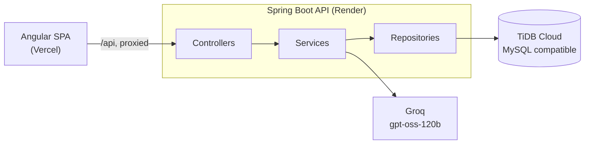

# Clausify

[](https://github.com/kymanirjarrett/clausify/actions/workflows/ci.yml)

AI contract analysis for freelancers: upload a contract PDF and get a risk score, the clauses worth worrying about, and fairer wording to ask for.

**Live:** https://clausifysolutions.vercel.app (the free API sleeps when idle, so the first request after a quiet period can take up to two minutes)

## Features

- **Risk analysis:** a 0 to 100 score and every flagged clause across eight categories (payment, liability, indemnification, IP, termination, non-compete, confidentiality, jurisdiction), each with an explanation and suggested revision. Failed analyses can be retried without re-uploading.
- **Compare to standard:** the closest clauses from a 104-clause library, marked favorable or unfavorable.
- **Compare versions:** a sentence and word diff of a revised contract, with the change in risk.
- **PDF report** of any analysis, and an account page with your history.
- **Private by design:** PDFs are never stored, only their extracted text, and every record is visible only to its owner.

## Tech stack

Angular 22 with Tailwind CSS v4 · Spring Boot 4.1 on Java 21 · Spring Security with JWT · MySQL with Flyway · Groq `gpt-oss-120b` through Spring AI · Apache PDFBox · JUnit, Testcontainers, Vitest, Playwright · GitHub Actions · Vercel, Render, and TiDB Cloud

## Architecture



- **Layered API:** controllers only handle HTTP and DTOs, services hold the business rules, and Spring Data repositories scope every query to the signed-in user (another user's record is a 404).
- **Background analysis:** an upload extracts the text in memory, returns `202 Accepted`, and analyzes it asynchronously (`UPLOADED → ANALYZING → ANALYZED / FAILED`).
- **No vector database:** clause similarity uses a word-based embedder and cosine similarity in Java, which fits the free tier's 512 MB.
- Each decision and its trade-offs are recorded in [`docs/adr/`](docs/adr/).

## Run it locally

Requires JDK 21+, Docker, and Node.js LTS.

```bash
docker compose up -d                       # MySQL 8.4 on localhost:3307
cd backend && ./mvnw spring-boot:run       # API on :8080, no env vars needed
cd frontend && npm install && npm start    # web app on http://localhost:4200
```

Locally, analysis uses a fake analyzer with fixed findings, so no API key is needed. Sample contracts are in [`backend/src/test/resources/contracts/`](backend/src/test/resources/contracts/).

```bash
cd backend && ./mvnw verify                # backend tests against MySQL, coverage floor
cd frontend && npx ng test --watch=false   # frontend unit tests
cd frontend && npm run e2e                 # Playwright journeys (needs the API running)
```

## Deployment

The browser only talks to Vercel, which proxies `/api` to the API on Render, so there is no CORS. Render deploys `main` after CI passes, and Flyway applies new migrations on startup. Secrets live in the Render dashboard; [`.env.example`](.env.example) lists every variable.

## Team

| | GitHub | Built |
|---|---|---|
| Kymani Jarrett | [@kymanirjarrett](https://github.com/kymanirjarrett) | Architecture, backend, frontend, AI integration, CI/CD, deployment |
| Ashton Cashier | [@Ashton525](https://github.com/Ashton525) | Contract delete and analysis retry |
| Rival Young | [@RivalJ](https://github.com/RivalJ) | Analysis and findings schema |
| Venkat Yuva Raaj Narra | [@Venkat-YuvaRaaj](https://github.com/Venkat-YuvaRaaj) | Planning and design |

**Code reviewers**, who reviewed the code and contributed fixes: [@agyemajl](https://github.com/agyemajl), [@ely-bush](https://github.com/ely-bush), [@poudelsv](https://github.com/poudelsv), [@willisgr](https://github.com/willisgr), [@winnieduong](https://github.com/winnieduong).

## Disclaimer

Clausify assists with contract review. It is not legal advice and does not replace a licensed attorney.
